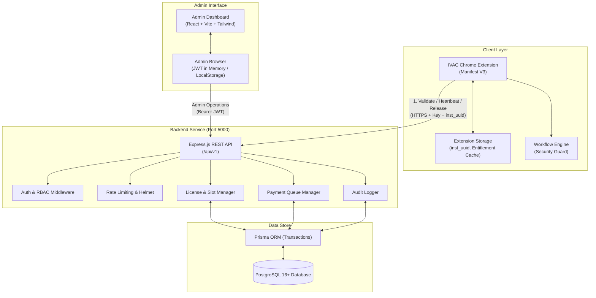
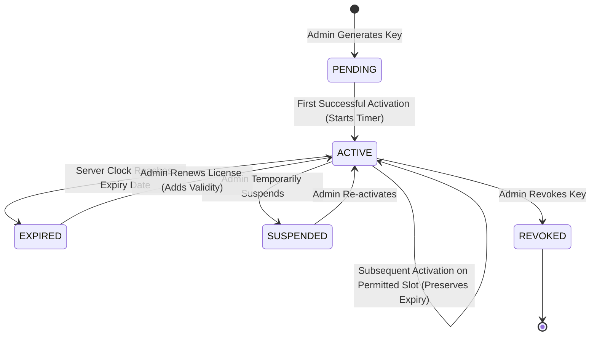
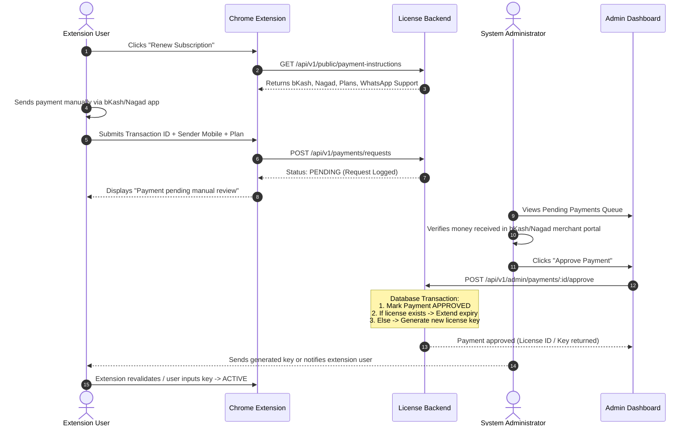

# IVAC Premium System — Architecture & Design

## 1. System Overview

The **IVAC Premium Automation & License Management System** is an enterprise-grade, server-authoritative software licensing and distribution platform built specifically for the **IVAC Automation Chrome Extension**.

The system is strictly separated into three independently maintainable, buildable, and deployable projects:

```
IVAC-Premium-System/
├── IVAC-Automation/         # Manifest V3 Chrome Extension (Client)
├── ivac-license-backend/    # Node.js + Express + TypeScript + PostgreSQL (API Server)
├── ivac-license-admin/      # React 18 + Vite + Tailwind CSS + TanStack Query (Admin Portal)
└── docs/                    # Technical Architecture, API, Security, & Deployment
```

---

## 2. High-Level Component Architecture



---

## 3. Core Architectural Principles

### 3.1 Strict Project Decoupling
- **No Shared Code Bundling:** The Chrome extension, the backend service, and the admin panel do NOT import files across repository boundaries.
- **Contract-Based HTTP Integration:** Communication occurs strictly via standardized JSON REST APIs over HTTPS.
- **Independent Life Cycles:** The extension can run and function without the admin portal being active; the backend operates headlessly.

### 3.2 Server-Authoritative Licensing
- **Client Tamper Defense:** The Chrome extension client is considered untrusted. All license decisions (active status, expiration, slot limits, suspension, revocation) are evaluated atomically on the backend.
- **Dual-Layer Enforcement:**
  1. **UI Layer:** The extension dashboard and floating panel disable all automation triggers ("Start Automation", "Auto Login", "Book Appointment") and display status badges (`ACTIVE`, `EXPIRED`, `UNLICENSED`, `SUSPENDED`).
  2. **Engine Layer:** Even if a malicious user alters client DOM elements or triggers script methods directly, `workflowEngine.start()` executes an asynchronous server entitlement verification check before processing any applicant profiles.

---

## 4. License State Machine & Business Rules



### 4.1 Validity Timer Rules
1. **Key Generation in `PENDING` State:** Generating a license creates a key in the `PENDING` state. Its validity duration countdown **does not start** upon generation.
2. **First Activation Anchors Expiry:**
   - When a user inputs an unused key, the backend records `activatedAt = NOW(UTC)`.
   - The backend computes `expiresAt = activatedAt + (validityDays * 86400 seconds)`.
   - The license status transitions to `ACTIVE`.
3. **Immutability of Expiry across Secondary Devices:**
   - If a license permits 2 or more installations, activating the second installation links it to the exact same license record.
   - The `expiresAt` timestamp remains completely unchanged.
   - Secondary activations, reinstallations, or browser restarts **never** restart or extend validity.
4. **Renewal Formula:**
   - When an admin approves a renewal or extends a license:
     - If the license is already `EXPIRED`: `newExpiresAt = NOW(UTC) + (renewalDays * 86400s)`.
     - If the license is still `ACTIVE`: `newExpiresAt = currentExpiresAt + (renewalDays * 86400s)`.

---

## 5. Browser Installation Quota & Release Mechanism

### 5.1 Hardware-Free Installation Identity
- The extension generates a cryptographically secure random installation ID upon installation: `inst_<uuid>`.
- The ID is stored in `chrome.storage.local` (or `localStorage` in dev environments), persisting across browser updates and extension restarts.
- **Privacy First:** No hardware serials, MAC addresses, browser fingerprints, or canvas hashes are collected.
- **Accurate Semantics:** The system communicates "Registered Extension Installations" rather than "Physical Computers", accounting for profile resets.

### 5.2 Atomic Installation Slot Enforcement
- Every activation request presents `licenseKey` and `installationId`.
- The backend checks inside an isolated database transaction:
  ```ts
  const activeCount = await prisma.licenseInstallation.count({
    where: { licenseId: license.id, status: 'ACTIVE' }
  });
  if (activeCount >= license.maxInstallations) {
    throw new AppError(409, 'Maximum browser installation limit reached.');
  }
  ```
- If an existing record exists for `(licenseId, installationId)` with `status = 'REVOKED'`, it is reactivated within the available quota.
- If a new installation attempts to register while `activeCount == maxInstallations`, the request is rejected with HTTP `409 Conflict`.

### 5.3 Installation Release Workflow
1. User clicks **"Release This Installation"** in the extension UI.
2. A confirmation prompt warns the user that this browser will surrender its active slot.
3. The extension calls `POST /api/v1/licenses/release-installation` with `licenseKey` and `installationId`.
4. The server validates that this installation record belongs to the license, marks its status as `REVOKED`, and decrements the active count.
5. The local extension resets its license state to `UNLICENSED`.
6. Another browser is immediately eligible to claim the freed installation slot.
7. **Offline Safety:** If the network is unreachable, the release is aborted locally, and the user is informed that the slot remains reserved on the server until confirmed.

---

## 6. Offline Tolerance & Short-Lived Caching

To ensure smooth operation during transient network latency while preventing offline piracy:
1. **5-Minute Short-Lived Entitlement Cache:** Successful validations store an entitlement token containing:
   - `status`: Active status
   - `expiresAt`: UTC expiration timestamp
   - `signature`: Server HMAC-SHA256 signature
   - `lastCheckedAt`: Client timestamp
2. **Online Verification Requirement:**
   - First-time activation **must** connect to the backend.
   - Automation workflow startup (`workflowEngine.start()`) **must** verify that `expiresAt > NOW()` and that cache age is <= 5 minutes.
   - Releasing an installation **must** connect to the backend.
   - Submitting payment requests **must** connect to the backend.
3. **Graceful Network Drop Handling:**
   - If the extension initiates a routine background heartbeat while the user's internet is momentarily interrupted, it falls back to the local unexpired cache and does **not** falsely mark the license as expired.
   - If the server explicitly responds with HTTP `403` or `404` (`LICENSE_REVOKED`, `LICENSE_SUSPENDED`, `INVALID_LICENSE_KEY`), the cache is immediately invalidated and automation is halted.

---

## 7. Manual Payment Processing Flow



---

## 8. Data Privacy & Zero-Knowledge Security

The IVAC Premium licensing backend is architected with strict data isolation:
- **Zero Portal Data Collection:** The backend **never** receives, stores, or processes:
  - IVAC portal account passwords
  - OTPs or 2FA codes
  - Applicant passport numbers or personal names
  - Uploaded visa PDF documents or photos
- **One-Way Key Hashing:** License keys (`IVAC-XXXX-XXXX-XXXX-XXXX`) are stored in the database exclusively as `SHA-256` hashes (`licenseKeyHash`). Plaintext keys are revealed **only once** to the administrator upon generation.
- **Entitlement Signatures:** Backend entitlement responses include an HMAC-SHA256 signature computed with `ENTITLEMENT_SECRET`, guarding against local storage tampering.
